<p align="center">
  
</p>

<p align="center">
  <strong>The local quality investigator for QA and SDET teams.</strong><br>
  Explains why your tests failed, drafts evidence-backed bug tickets, and proposes fixes it has already tested.<br>
  On your own machine, with a person approving everything.
</p>

<p align="center">
  <a href="https://github.com/sbaqa/tessella/actions/workflows/ci.yml"></a>
  
  
  
  
</p>

<p align="center">
  <a href="#see-it-in-action">See it</a> ·
  <a href="#quick-start">Quick start</a> ·
  <a href="#the-big-picture">How it works</a> ·
  <a href="#results-so-far">Results</a> ·
  <a href="#pricing">Pricing</a> ·
  <a href="#status-at-a-glance">Status</a> ·
  <a href="#full-documentation">Full docs</a>
</p>

<p align="center">
  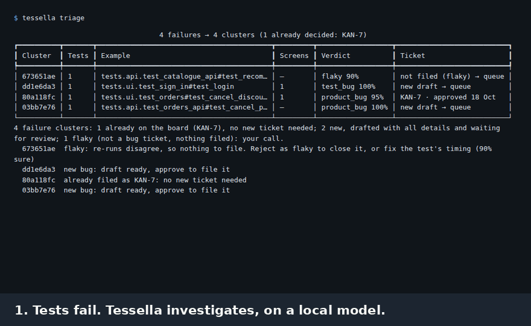
</p>

A nightly run fails 40 tests, and someone loses a morning working out which are real bugs, which are broken tests and which are the same problem 15 times. AI could help, but in many companies logs and code may not leave the building. Tessella does that investigation **inside your network**, on a small local model, and backs every conclusion with evidence you can check.

## What you get

<table>
<tr>
<td width="33%" valign="top">

### 🔍 Triage
Groups failures, re-runs them, reads logs, code changes and screenshots, then calls each one a product bug, test bug, environment problem, test data problem or flaky test.

</td>
<td width="33%" valign="top">

### 🎫 Tickets worth reading
Steps, actual and expected results, environment, suspected cause and suggested fix, with the evidence cited. Filed to Jira or GitHub only when you approve.

</td>
<td width="33%" valign="top">

### 🧩 Never file twice
Every run says what is already on the board, what is new and what needs your call. Near-duplicates in Jira are flagged before you file.

</td>
</tr>
<tr>
<td valign="top">

### 🛠 Fixer agent
Reads the code, tries an edit in a temporary copy and re-runs your tests. Only a fix that passes reaches the ticket. You put it on a branch with one command.

</td>
<td valign="top">

### 🔒 Local first
Runs on a laptop with no GPU. Every outbound call is allowlisted, every model call audited, and offline mode proves nothing left the machine.

</td>
<td valign="top">

### 📊 Review and report
A review queue, a drag-and-drop Board, a dashboard with measured time saved, a link into your Allure report and a summary comment on the pull request.

</td>
</tr>
</table>

## See it in action

Real screens from the included demo shop, on a small local model.

<table>
<tr>
<td width="50%">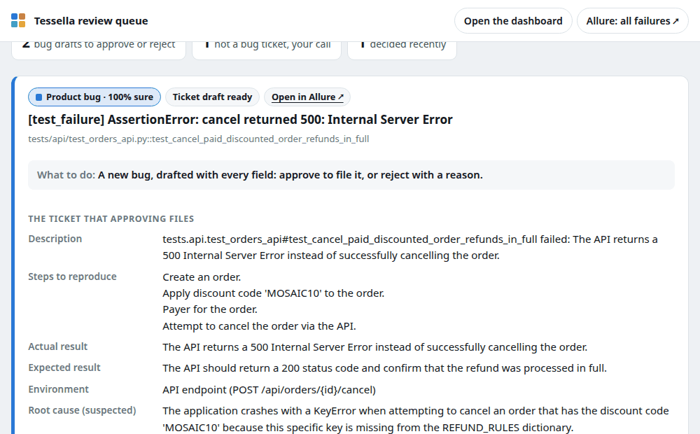<br><b>Review queue.</b> One card per failure, with what to do next.</td>
<td width="50%">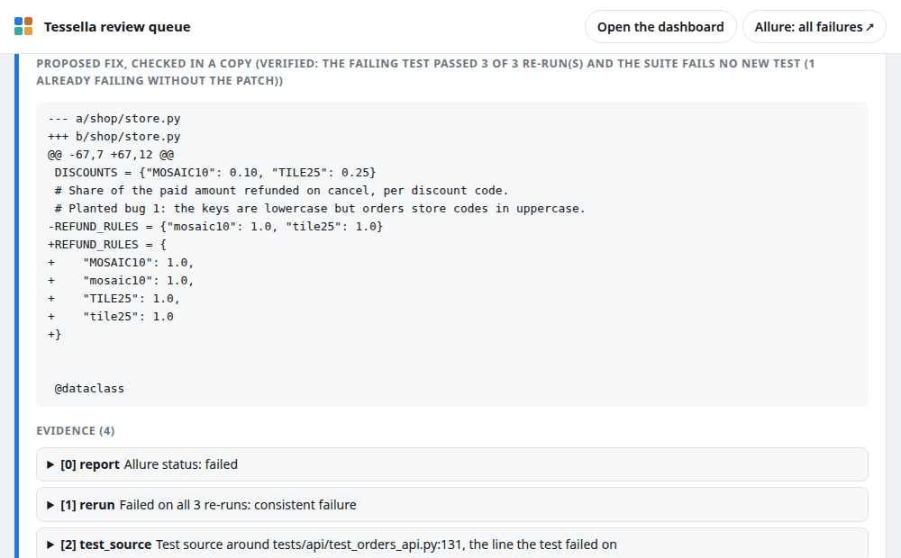<br><b>A checked fix on the ticket.</b> Tested before you ever see it.</td>
</tr>
<tr>
<td>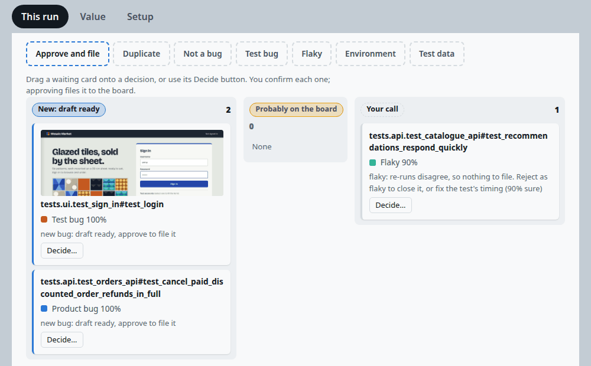<br><b>Board.</b> Drag a card onto a decision.</td>
<td>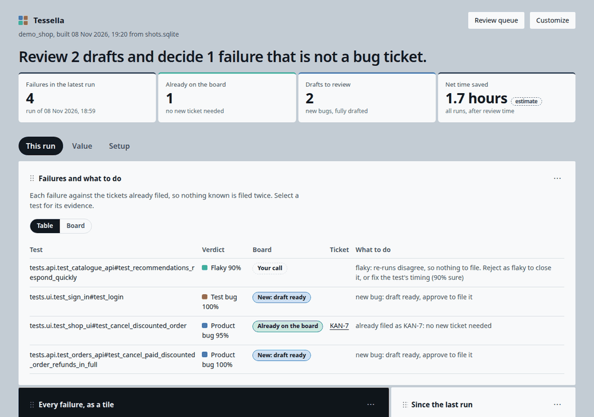<br><b>Report.</b> What this run means for the board.</td>
</tr>
<tr>
<td>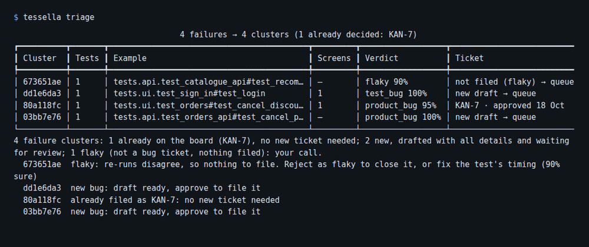<br><b>Terminal.</b> One sentence on what the run means.</td>
<td>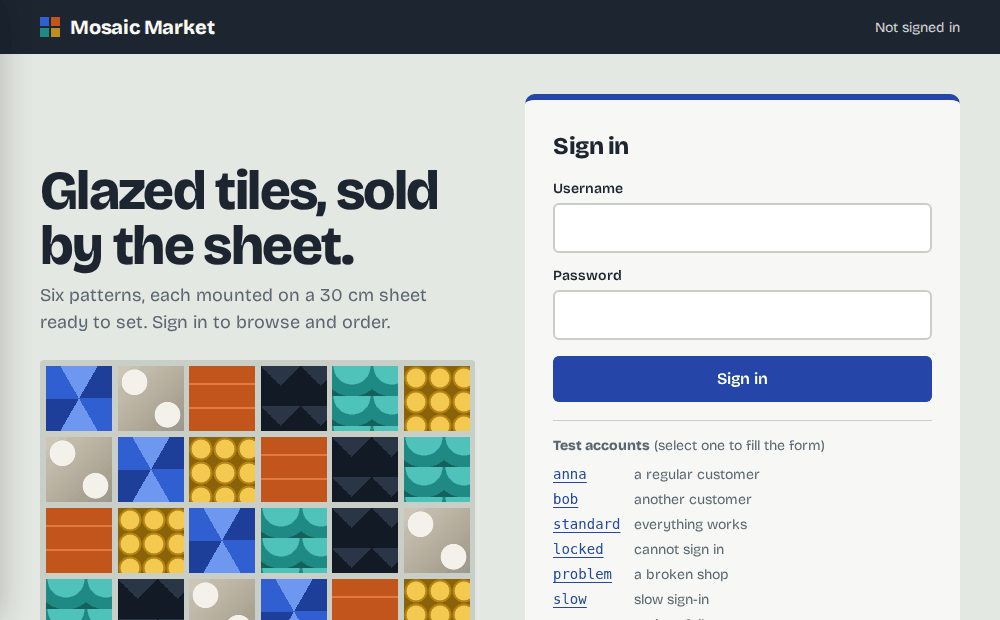<br><b>Demo shop.</b> Five planted bugs to practise on.</td>
</tr>
<tr>
<td colspan="2" align="center">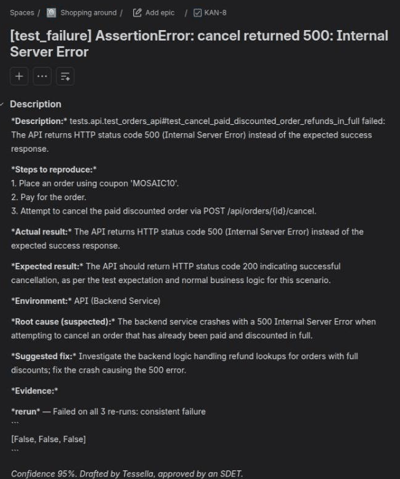<br><b>The filed ticket.</b> A real Jira ticket from the demo shop, every field written from evidence.</td>
</tr>
</table>

## Quick start

You need Python 3.12 and the [Allure command line](https://allurereport.org/docs/install/). This runs the demo shop's tests and shows the failures in the review queue:

```bash
git clone https://github.com/sbaqa/tessella && cd tessella
python3 -m venv venv && source venv/bin/activate && pip install -e ".[all,dev]"
cd examples/demo_shop && pip install -r requirements.txt
playwright install chromium && cp tessella.example.yaml tessella.yaml
bash run_suite.sh && tessella triage --no-model --no-rerun && tessella queue
```

Then open <http://127.0.0.1:8484>. For real verdicts, download the model once (3.4 GB) and triage again:

```bash
tessella models pull qwen3.5:4b && tessella triage
```

## Use it on your own project

From a clone, `tessella init` asks a few questions and writes your settings. Or write the few lines yourself:

```yaml
# tessella.yaml
inputs:
  reports: ["allure-report/"]        # or playwright-report/, junit.xml, a pytest-html file
rerun:
  command: "pytest {test_id} -q"     # how to run one failing test again
```

```bash
tessella models pull qwen3.5:4b      # once
tessella triage && tessella queue    # after any test run
```

| Works with | |
| --- | --- |
| **Test reports** | Playwright HTML, Allure, pytest-html, any framework that writes JUnit XML |
| **Flows** | Playwright traces, HAR files |
| **Findings** | Schemathesis, OWASP ZAP |
| **Backend logs** | Log files, Loki, Elasticsearch |
| **Ticket boards** | Jira (Cloud or self-hosted), GitHub Issues |
| **CI comments** | GitHub Actions, GitLab CI |
| **Local models** | Ollama (built in), llama.cpp server, vLLM, LM Studio |
| **Cloud models** | Optional, through LiteLLM and your data policy |

## Why not just paste the log into ChatGPT?

| Pasting into a chatbot | Tessella |
| --- | --- |
| Sees the one log you pasted | Re-runs the test, reads backend logs, code changes and screenshots |
| Answers confidently either way | Must cite evidence, or says "unknown" and drafts nothing |
| One failure at a time | Groups 40 red tests into the few real problems |
| Forgets everything | Remembers your decisions and never asks twice |
| Suggests a fix you have to try | Tests the fix first, and only shows one that passed |
| Your logs and code leave the building | Runs on your machine, and can prove it |

## The big picture

Plain code gathers the evidence first. The model only reasons over that evidence and must cite it, which keeps small local models useful and makes every verdict checkable.

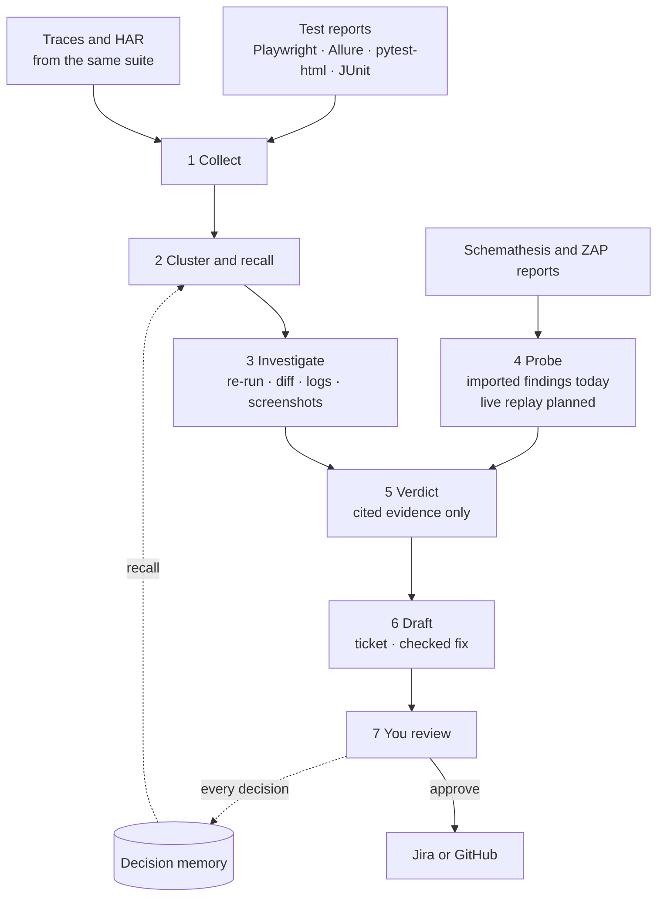

<details>
<summary><b>🧭 What happens to each failure</b></summary>

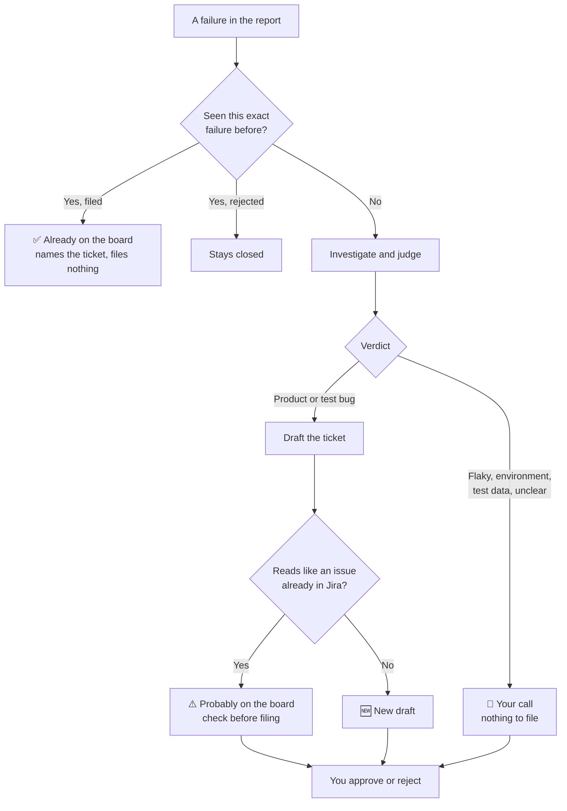

</details>

<details>
<summary><b>🛠 How the fixer agent checks a fix</b></summary>

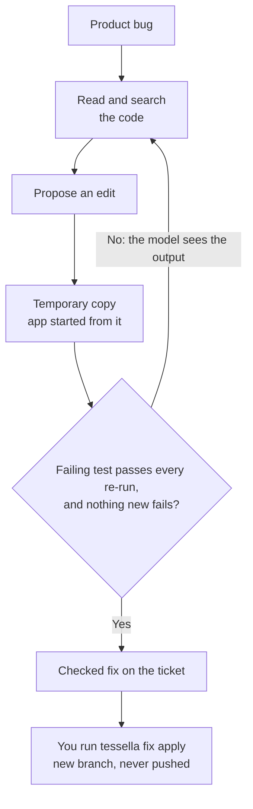

Your own files are never touched until you run `tessella fix apply`. A person still reads every fix: passing tests prove it works where tests look, not everywhere.

</details>

<details>
<summary><b>🔒 What stays on your machine, and what can leave</b></summary>

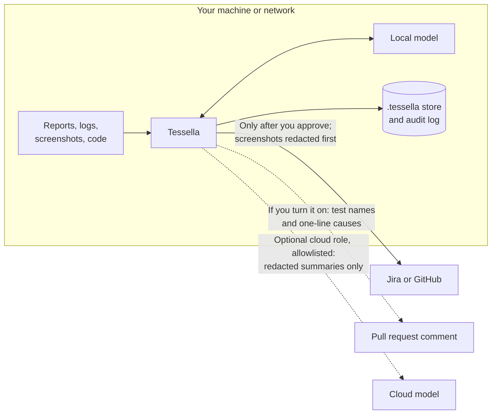

</details>

<details>
<summary><b>💬 How it fits into CI</b></summary>

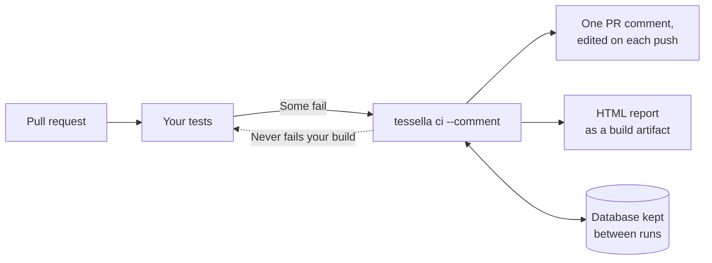

</details>

## Results so far

| What was checked | Result |
| --- | --- |
| 🎯 Triage on the demo shop, local qwen3.5:4b on CPU | **12 of 12** correct (4 failures, 3 runs each, same answer every time); 4 of 4 again after the suite was rewritten |
| 🎫 Filing to a real Jira Cloud project | 3 tickets filed; approving the same failure again links back instead of filing twice |
| 🛠 Fixer agent on a real planted bug | Checked fix in 4 to 6 steps across two runs: the failing test passed 3 of 3 re-runs and the API suite gained no new failures |
| 🧪 Tessella's own tests | About 300, run on every push; model calls are faked |

These are small numbers on a demo target, a smoke test rather than an accuracy figure. The flaky verdict came from the re-run rule, not the model.

**What you need:** about 16 GB of RAM, no GPU, 3.4 GB of disk for the model, Python 3.12. Expect 1 to 5 minutes per failure on an 8-core CPU, depending on how long your tests take to re-run. Cloud models are optional.

## Pricing

**Tessella is free for now**: open source under [Apache-2.0](LICENSE), with no seats and no per-test fees. You only bring the machine it runs on. A cloud model is optional and billed by its vendor.

| Tool | Starting price | Higher plans | Good to know |
| --- | --- | --- | --- |
| 🧩 **Tessella** | **Free** | None today | Runs on your hardware; data stays with you |
| [BrowserStack Automate](https://www.browserstack.com/pricing?product=test-reporting) | $99/month, billed annually (reporting included) | $225/month, billed annually, adds AI failure analysis | Runs tests on their cloud; reporting for tests run elsewhere is quote only |
| [ReportPortal](https://reportportal.io/pricing/saas) | Free to self-host | Cloud from $569/package/month; $2,659 Business; Enterprise by quote | Reporting and history, no LLM investigation |
| [TestDino](https://www.testdino.com/pricing) | Free: 5,000 executions/month, 1 seat | $39/month Pro, $79/month Team (discounted prices shown); Enterprise custom | Playwright-first SaaS |
| [Playwright Healer](https://playwright.dev/docs/test-agents) | Free | None | You pay for the AI tool you run it with; repairs tests only |

Public list prices checked on 8 November 2026. They change often, and these tools do different jobs, so compare what you actually need.

## Status at a glance

| Level | What |
| --- | --- |
| ✅ **Proven on real runs** | Triage on a local model · Jira filing and duplicate checks · review queue, report and Board · fixer agent on a planted bug · Schemathesis imports · offline bundle install |
| 🧪 **Tested with simulated services** | PR comments on GitHub and GitLab · GitHub Issues filing · Loki and Elasticsearch logs · ZAP imports · team server on a GPU |
| 🗓 **Planned** | Probe live replay · regression test export · automatic visual baselines |

Early development: expect rough edges. The [full status table](#what-works-today) says exactly how each part was tested.

**Start here if you are:** 🧑‍💻 an SDET → [Getting started](#getting-started) · 📈 a QA lead → [The report](#the-report) and [Time saved](#time-saved) · 🛡 a security reviewer → [Security and privacy](#security-and-privacy) and [Offline mode](#offline-in-containers-and-for-a-team) · 🔧 a contributor → [Development](#development)

---

# Full documentation

Everything else, folded away. Select a topic to open it.

## 📖 Understand

<a id="why-tessella-exists"></a>
<details>
<summary>🤔 <b>Why Tessella exists</b></summary>

Two problems meet in every QA team that runs automated tests at scale.

**Red builds eat hours every day.** A nightly run fails 40 tests. Someone opens the report and
starts guessing: which failures are real product bugs, which are broken tests, which are a
flaky environment, which are the same problem showing up 15 times? The answer usually takes
hours of re-running tests, reading logs and comparing screenshots, and the bug ticket that
comes out is often thin: "test X failed, see report".

**AI could help, but in many companies it is not allowed to.** The AI failure-analysis
features in cloud testing platforms send logs, stack traces, screenshots and code to a vendor.
In banks, fintech, insurance, healthcare, government and AI labs, the security team usually
says no. The [World Quality Report 2025](https://www.capgemini.com/news/press-releases/world-quality-report-2025-ai-adoption-surges-in-quality-engineering-but-enterprise-level-scaling-remains-elusive/)
lists data privacy risks (67%) among the top barriers to scaling AI in quality engineering,
alongside integration complexity (64%).

Tessella is built for exactly that gap: a real investigation of test failures, run inside your
own network, with every conclusion backed by evidence a person can check and every ticket
approved by a person before it is filed.

</details>

<a id="what-it-does"></a>
<details>
<summary>🔍 <b>What it does</b></summary>

Tessella answers one question for every build: **is it safe to ship, and if not, why?**
It has two ways of finding the answer, working on the same data:

- **Triage listens.** It reads the reports your tests already produce (Playwright HTML,
  Allure, pytest-html, JUnit), groups the failures, re-runs them, looks at what changed in git,
  reads backend logs, compares failure screenshots with the last green run, and decides for each
  group: product bug, test bug, environment, test data or flaky.
- **Probe looks (partly built).** Its goal is to replay the request flows your tests already
  recorded (Playwright traces, HAR files) with changes: another user, invalid input, steps out
  of order, the same request in parallel. Today it links IDs and plans those changes but sends
  nothing. Real findings come from Schemathesis and OWASP ZAP reports you import. Live replay
  is the v2 milestone.
- **Fix proposes.** For a product bug, the fixer agent reads the code the failure points to,
  tries an edit in a temporary copy and re-runs your tests. Only a fix that passes is put on
  the ticket, and you apply it yourself.

Every signal from either side becomes a **Case**. Cases go through one loop, into one review
queue, and teach one memory. Nothing reaches Jira or your repository without an SDET's approval.

</details>

<a id="the-value-for-quality-teams"></a>
<details>
<summary>👥 <b>The value for quality teams</b></summary>

| Who | What changes for them |
| --- | --- |
| **SDETs and automation engineers** | 40 red tests become a handful of clusters, each with a likely cause and its evidence (re-run result, git diff, log lines, outlined screenshot). Flaky tests and environment outages are recognized instead of investigated again. Test bugs come with a proposed patch. |
| **QA leads and managers** | Triage time drops and becomes measurable. Tickets reaching developers are complete and consistent. The approval and rejection rate of drafts shows, week by week, how much noise is being removed. |
| **Developers** | Bug tickets arrive with a short repro, the failure screenshot with the changed area outlined, the relevant log lines and the suspected commit, instead of "test failed, see report". |
| **Security and compliance** | The tool runs inside the network. Every outbound call is allowlisted, every model call is written to an audit log with what was sent, and `tessella doctor --egress` proves that nothing else can leave. |
| **Engineering leadership** | Faster, better-founded release decisions, without buying a cloud platform the security team will not approve, and without per-analysis AI quotas. |

What Tessella deliberately is **not**: a test reporting dashboard (keep ReportPortal or Allure
for that), a test generator, a tool that silently heals locators at run time (the Playwright Healer
agent covers that for free), an execution grid, or an autonomous bug filer. The fixer agent only proposes checked
fixes; a person applies them.

</details>

<a id="how-it-compares"></a>
<details>
<summary>⚖️ <b>How it compares</b></summary>

| Capability | Tessella | Cloud test platforms (e.g. BrowserStack) | ReportPortal | Playwright-first SaaS (e.g. TestDino) | Playwright Healer | Small open-source analyzers |
| --- | --- | --- | --- | --- | --- | --- |
| Data stays in your network | Yes | No | Yes (self-hosted) | No | Yes | Yes |
| Real investigation | Re-run, diff, logs, screenshots | Logs, screenshots | Labels from history | Report only | Replays the UI test | Report only |
| Finds bugs tests missed | From imported Schemathesis and ZAP reports today; built-in probe planned | No | No | No | No | No |
| Frameworks and reports | Any report | Best on own runs | Many agents | Playwright-first | Playwright UI | Mostly Playwright |
| Bug tickets | Drafts that learn | One-click to Jira | Links Jira | None | None | Often auto-filed |
| AI model choice | Local, hybrid or cloud, by policy | Vendor's | No LLM | Vendor's | Your editor's | Your API key |
| Price | Free for now ([details](#pricing)) | Paid plans | Free to self-host; paid cloud | Free tier; paid plans | Free, plus your AI tool | Mostly free |

Competitor descriptions are a summary of their public documentation and have not been re-checked
recently. See each vendor's current documentation.

</details>

<a id="how-it-works"></a>
<a id="the-loop"></a>
<a id="everything-is-a-case"></a>
<a id="stage-by-stage"></a>
<a id="screenshots-as-evidence"></a>
<a id="models-and-data-policy-local-reads-cloud-writes"></a>
<a id="the-review-queue-and-how-it-learns"></a>
<a id="the-report"></a>
<a id="time-saved"></a>
<a id="tickets-runs-and-the-short-page"></a>
<details>
<summary>🧠 <b>How it works</b></summary>

<details>
<summary><b>The loop</b></summary>

See [The big picture](#the-big-picture) for the diagram.

Deterministic code gathers evidence first; a model only reasons over that evidence and must cite
it. This keeps small local models useful and makes every verdict checkable.

</details>

<details>
<summary><b>Everything is a Case</b></summary>

One data model carries everything (`src/tessella/models.py`):

| Model | What it holds |
| --- | --- |
| `Case` | One signal: a failed test (`origin=test_failure`) or a probe finding (`origin=probe_finding`), with its message, stack, screenshots, flow, evidence, verdict, draft and decision |
| `Evidence` | One checkable fact: a re-run result, a git diff, log lines, a visual diff, a vision reading, a probe replay. Each has a one-line summary, the exact excerpt and an optional image |
| `Flow` / `Step` | The HTTP request chain behind a test, from a Playwright trace or a HAR file |
| `Verdict` | Category (`product_bug`, `test_bug`, `environment`, `test_data`, `flaky`, `unknown`), confidence, root cause, and which evidence it relies on |
| `Draft` | A ticket, a test patch or a regression test waiting for review |
| `Decision` | What an SDET did with a draft (approve, edit, reject with a reason, delete) |

Readers turn every input into Cases and Flows; no later stage touches raw files.

</details>

<details>
<summary><b>Stage by stage</b></summary>

1. **Collect.** Readers parse reports from the data they embed, not the page layout: Playwright
   HTML reports carry their results inside the page, Allure writes JSON next to its HTML,
   pytest-html embeds a JSON blob. Failure screenshots are picked up from all three. Traces and
   HAR files become Flows. Secrets (tokens, cookies, card-like numbers, IBAN-like strings,
   configured keys) are masked as data is read.
2. **Cluster and recall.** Each failure gets a signature: the error message with numbers, IDs,
   timestamps and quoted values replaced by placeholders, plus the file and line of the first
   project stack frame. Same signature, same cluster: 40 red tests usually become a handful of
   problems, and each is investigated once. Past decisions for the signature are recalled, so a
   pattern you already rejected is not drafted again.
3. **Investigate.** First, once per run, check the `preflight.urls`: if one is down, every
   failure is labelled environment with that evidence. Then for each cluster: re-run the test
   with your own command (passes on retry means flaky), compare the failure screenshot with
   the last green one, ask the vision role what the screen shows, show the failing test's
   source, read backend logs (a file, Loki or Elasticsearch) from the test's own start and end
   time as the report records them (errors and tracebacks first), and diff the files on the
   failure's stack against the last green run (`inputs.green_ref`, or the commit of the last
   triage that saw no failures, recorded automatically in a git repository).
4. **Probe.** Link IDs between steps of a flow (an order ID returned by step 2 and used in
   step 4), then replay the flow with mutations: boundary values, wrong types, a second user,
   anonymous access, skipped or repeated steps, parallel sends. Oracles flag server errors,
   invalid input accepted, a rejected request that still changed state, another user's data
   returned, and duplicate effects. Delta debugging shrinks a failing flow to the fewest steps.
   Replay is not built yet. Today, findings come from established testers instead: pass a
   Schemathesis JUnit report or an OWASP ZAP JSON report to `tessella triage` (see
   [Findings from Schemathesis and ZAP](#findings-from-schemathesis-and-zap)).
5. **Verdict.** Cheap rules first (a pass on re-run means flaky; a failed pre-flight means
   environment). Otherwise the reader model gets a compact evidence pack and must answer in JSON,
   citing evidence by number. A verdict that cites nothing, cites evidence that does not exist,
   or is below the confidence threshold becomes `unknown`: shown, never drafted. When the
   first answer is unsure, the reader may ask for up to `investigate_steps` more pieces of
   evidence from a fixed menu (a wider log window filtered by a word, one file's diff, more of
   the test, a close-up of a screenshot region, a re-run with detailed output) and answer
   again. Only tools that can work for that failure are offered, and each result is numbered
   evidence like the rest.
6. **Draft.** Product bugs become ticket drafts with a description, steps to reproduce,
   actual result, expected result, screenshots and the cited evidence. Test bugs get a patch
   written by the fixer role, applied to a temporary copy of the repository and re-run there:
   it is kept only when the test passes on every re-run, and a person applies it. A local
   fixer also sees the evidence pack; a cloud fixer only the redacted summary and the test
   file. Product bugs can also get a fix from the fixer agent, checked the same way with the app
   started from the copy. Regression tests from approved probe findings are planned. Environment,
   data and flaky problems become a line in the summary.
7. **Review.** The SDET decides in the review queue. Only approval files to the configured
   board (Jira or GitHub Issues — see `board:` in configuration).

</details>

<details>
<summary><b>Screenshots as evidence</b></summary>

For UI failures, logs often miss the real cause: a dialog covering a button, an error banner,
an empty list, a broken layout. Tessella uses screenshots in two layers:

- **Visual diff (no model).** The failure screenshot is compared pixel by pixel with the last
  green screenshot of the same test. The evidence says how much of the screen changed and where,
  and Tessella saves a copy with the changed region outlined. Save a baseline with
  `tessella baseline --test "<test title>" green.png`.
- **Vision reading.** The `vision` model role describes what on the screen explains the failure.
  The description becomes cited evidence like any other.

Screenshots appear in the review queue and in ticket drafts. By default the data policy never
lets screenshots leave the network, so the vision role normally runs on a local model.

</details>

<details>
<summary><b>Models and data policy: local reads, cloud writes</b></summary>

Tessella has four model roles, each of which can be local or cloud:

| Role | Sees | Typical choice |
| --- | --- | --- |
| `reader` | Redacted logs, stack traces and evidence excerpts | Local (Ollama, vLLM) |
| `vision` | Failure screenshots | A local vision-capable model |
| `fixer` | Only a redacted summary and the failing test file | Cloud allowed, optionally with approval per call |
| `embedder` (optional) | The test name and normalized error, for similarity recall | A local embedding model (`nomic-embed-text`) |

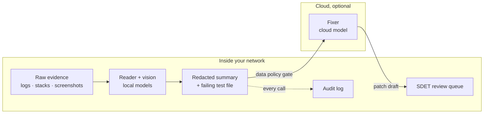

Every model call goes through one gateway (`src/tessella/integrations/llm.py`), which checks:

1. the role is configured;
2. for a cloud model, every data class in the call is allowed by the data policy (by default
   only `redacted_summary`, `failing_test_file` and `diff_hunk` may leave; `raw_logs`,
   `stack_traces`, `screenshots` and `test_data` never do);
3. the model's host is on the network allowlist;
4. a person approved the call, if the role has `approve_each_call: true`.

Then the call is written to `.tessella/model_calls.jsonl`: role, local or cloud, host, data
classes, size and a SHA-256 of what was sent (optionally the full text). A cloud reader asked to
read log excerpts is refused, and the verdict says why, instead of silently sending logs out.

This makes privacy a dial rather than a wall:

- **Air-gapped:** only local roles. Nothing leaves.
- **Hybrid:** local reader and vision, cloud fixer for stronger patch writing.
- **Cloud:** all roles cloud, with the policy still deciding which data classes go.

**Local first.** Local roles (Ollama, or llama.cpp server, vLLM and LM Studio running inside
your network) are called directly through `net.py`, so they obey the allowlist and need no
LiteLLM. LiteLLM (`tessella[llm]`) is only needed if you choose a cloud model for a role.

**Making small local models dependable.** The reader's reply must match a JSON schema, which
local servers enforce while the model writes (Ollama `format`, `response_format` elsewhere).
A reply that still fails validation is retried once with the error shown, and common slips
(steps as a list, "85%" for 0.85) are repaired. By default the reader does one job per call:
it classifies first, then writes the ticket fields only for product and test bugs
(`two_step`). A verdict within `vote_margin` of `min_confidence` is asked again `votes - 1`
times at a higher temperature; the majority wins and the agreement is folded into the
confidence (a split vote ends up `unknown`). The evidence pack is fitted to `num_ctx`: every
item keeps its number, long excerpts keep their head and tail, and the failing test's own
lines around the failure are included. Screenshots are scaled to `max_image_px` before the
vision role sees them, with a close-up of the region that changed since the last green run.

**Lean evidence packs.** Before the pack is fitted, log, trace, artifact, report and re-run
excerpts are trimmed of noise. Runs of repeated lines (identical, or identical once
timestamps, UUIDs, hex ids, durations and numbers are masked) become the first line with
` (×N)`. Stack traces (Python, pytest, JS/Node, Java) drop runs of library frames
(site-packages, node_modules, venv, the standard library, `node:internal`, the JDK) as
`… N library frames …`, but keep your own frames, the first frame, the last two and every
error line. Test source and diffs are never touched, and evidence numbers stay the same.
The pack is also capped at `max_evidence_tokens` (default 3000) even when `num_ctx` has room
for more: a small model judges a short, dense pack better and faster. Set it to `null` to
fill the context window as before.

**Speed.** Re-runs stay one cluster at a time; model calls run `parallel` clusters at once
(match your server's slots). Ollama keeps the model loaded for `keep_alive` and is warmed up
before the first cluster. Replies to identical prompts at temperature 0 come from
`.tessella/model_cache.sqlite` (`cache.enabled`), so re-triaging unchanged failures costs no
model time; a cached reply makes no call, so it adds nothing to the audit log.

**Choosing and measuring a model.** `tessella models recommend` reads this machine's memory
(GPU, Apple unified memory or RAM) and suggests the largest Qwen 3.5 that fits, with
`num_ctx` and `parallel`; without a GPU it stops at 9b (4b under 8 cores), because bigger
models answer too slowly. `tessella models bench` times load, prompt and reply speed on a
made-up failure. `tessella eval` then scores the reader on your own failures against a golden
file (`examples/demo_shop/tessella.golden.yaml` is one): accuracy (an `unknown` counts as
wrong), unknown rate, Brier score of the stated confidence, ticket field completeness, facts
the diagnosis should mention, seconds per cluster and, with `--runs`, how often repeated runs
agree. Repeat `--model` to compare models on the same evidence. Eval writes nothing to the
store, ignores memory and the reply cache, and appends each result with a hash of the prompts
to `.tessella/eval_history.jsonl`, so a prompt or model change shows up in the numbers.
`--min-accuracy 0.8` makes it a CI gate.

After the summary, eval prints a table per model with one row per failure judged: the test,
its error message, the expected and the model's category (✓/✗), the stated confidence, the
root cause with the evidence numbers it cites, and the seconds it took. Golden entries no
failure matched are listed too. Every model call the run made (reader, vision, fixer) is kept
exactly as sent and answered in `.tessella/eval_runs/<UTC time>-<model>.jsonl`, one file per
model, whose path is printed at the end: role, model, the full messages (images replaced by a
placeholder naming the file and its size), the reply schema, the raw reply and any thinking,
tokens, seconds, the golden entry and run it was for, and whether the reply came from the
cache. `--show-prompts` also prints each call's prompt and reply, dimmed, after the table.
Only eval records these; triage does not. `--json` includes the per-failure fields and the
calls file. Eval only measures: to review each failure and approve or reject its ticket, use
`tessella queue`.

</details>

<details>
<summary><b>The review queue and how it learns</b></summary>

The review queue (`tessella queue`, at `http://localhost:8484`) lists open Cases with their
verdict, cited evidence, screenshots and the drafted ticket (description, steps to
reproduce, actual result, expected result). For each draft an SDET can:

| Action | Effect | What Tessella learns |
| --- | --- | --- |
| Approve | Ticket filed to the configured board (`board: jira` or `board: github`) | This signature is a real bug |
| Edit, then approve | Fix any field in the queue (Edit draft), save, then approve to file your text | Tessella's own text is kept, so Undo my edits restores it, and a later triage keeps your words |
| Reject with a reason | Not a bug, test bug, environment, test data, flaky or duplicate | The next run labels the same signature instead of drafting it again |
| Delete | Removed as noise | Nothing: deletes are not training signal |

Decisions are stored locally in SQLite. A failure with a signature the team already decided
is recalled without asking a model. With an `embedder` role, Tessella also finds failures
that read like decided ones even when the signature changed (a refactor moved the line):

- at `memory.similar_threshold` or above, the earlier decision becomes cited evidence ("Reads
  like a failure the team approved as KAN-12 on 2026-10-20, similarity 0.94") and its ticket
  is shown on the draft as a possible duplicate. It never skips the investigation;
- the `memory.examples` most similar reviewed failures are shown to the reader as calibration
  examples, so it judges the way your team does.

Vectors live in `.tessella/vectors.sqlite`; `tessella reindex` embeds decisions made before
the embedder was set up, or brought in by `tessella merge`. `tessella export-dataset` writes
reviewed decisions as a chat-format JSONL file for fine-tuning a local model (Unsloth,
Axolotl, MLX-LM): approvals keep the verdict, rejections as test bug, environment, test data
or flaky become corrections. It holds redacted evidence, so keep it on your machine. The
queue page also shows a "Recently decided" list: each entry names the test (its id, or its
title), the verdict's category and confidence, who approved or rejected it and when, the
ticket key as a link to the ticket (or "no ticket"), and the error message underneath. When
the queue is empty but the latest run's failures match earlier decisions, the page says so at
the top ("Today's 3 failures match earlier decisions — see below. To review one again:
`tessella forget KAN-7`"), so an empty queue after a red build is not a mystery.

**Jira recall and dedup.** Each tessella-filed Jira issue carries a `tessella-<signature>`
label. Approving a signature that is already labelled in Jira links to that issue instead of
filing a duplicate — so two people (or machines) can't file the same bug twice. On every
triage run, tessella checks that previously filed Jira tickets still exist; if one was
deleted, its cluster drops the stale "already filed" state and reappears in the queue for
re-approval. An approval made before any board was set up filed nothing, so once Jira or
GitHub is configured the next triage judges that failure again and puts it back in the queue,
saying who approved it and when. Issues that someone filed by hand, or that describe the same failure in other
words, are found by **duplicate search**: when a draft is written, Tessella searches the project
for its most distinctive words, scores those hits and every issue Tessella filed (`tessella` label), and lists the issues that read like it (cosine similarity with
the embedder role at `jira.duplicate_threshold`, or shared summary words at
`jira.duplicate_text_threshold`) on the draft and in the filed body as possible duplicates. The
reviewer decides; nothing is skipped. Offline mode skips the search. These Jira checks fail open: with no Jira config, no token, or a network error,
triage and approval behave exactly as the local-only flow.

</details>

<details>
<summary><b>The report</b></summary>

`tessella report` writes one HTML file, `.tessella/report.html`, from what Tessella has
already stored. Open it from disk, attach it to a CI run, or send it to someone who has not
installed anything: it has no external scripts, fonts or images, and nothing on it is fetched.

For a page that stays current while you review, start the review queue (`tessella queue`) and
open `http://localhost:8484/report`. It is the same dashboard, rebuilt from the live store on
every load, so a decision you make in the queue shows up on the next refresh. It makes no Jira
calls, so it never waits on the board. The queue page links to it.

The page opens with the run's headline ("3 already on the board (KAN-7, KAN-8, KAN-9), no new
tickets needed") and four numbers: failures in the latest run, already on the board, drafts to
review and net time saved. The panels sit in three tabs: **This run** (failures and what to do,
the tiles, since the last run), **Value** (time saved, failures to tickets, reviewer agreement,
ticket outcomes) and **Setup** (runs, evidence, models, probe).

| Panel | What it shows | Where the numbers come from |
| --- | --- | --- |
| Every failure, as a tile | One tile per failing test, grouped by cluster, coloured by verdict; filled is approved, outlined is waiting, hatched is rejected. Filter by verdict or status | Cases and decisions in the store |
| From failures to tickets | Rows of tiles from failures to clusters to drafts to approved to tickets filed, so you can see grouping shrink the work | The same |
| Time saved | Net hours: manual work avoided minus the time people spent reviewing, with every input labelled Measured, Calibrated or Assumed | Review timestamps, your timed investigations and the decisions in the store. See [Time saved](#time-saved) |
| What happened to the tickets | Of the tickets that closed, how many were fixed, closed as not a bug, or closed as duplicates, and how many are still open | `tessella sync`, which reads each filed ticket's status from Jira. The page itself never calls Jira |
| Since the last run | New clusters, clusters that came back after a gap, clusters still failing, and clusters not seen this run | The `runs` table: the latest run against the one before it |
| Do reviewers agree? | Approval rate, overall and per verdict, with reject reasons | Decisions. Under five reviews it says it is too early to read a trend |
| How well verdicts are backed | Share of verdicts that cite evidence, were re-run, have a screenshot | The evidence stored on each case |
| Runs | Failures and clusters per triage, and clusters that came back run after run | A `runs` table that every `tessella triage` now appends to |
| Models and data | Calls per role and model, local versus cloud, images sent | `.tessella/model_calls.jsonl` |
| Probe | Flows read and changes planned. Planned only: replay is not built, so it never shows a finding | `tessella probe` |
| Failures and what to do | Every failure once, the latest run first: verdict, board status (already on the board, probably on the board, new draft, your call, decided earlier), ticket link and what to do; earlier runs' failures below | The latest run in the store, its drafts' duplicate-search matches, and decisions made since. No Jira call |

"Failures and what to do" switches between a **Table** and a **Board**: the latest run as cards
in columns (new draft, probably on the board, your call, already on the board). On the live page
(`tessella queue`, then Report), drag a waiting card onto Approve and file, Duplicate, Not a bug,
Test bug, Flaky, Environment or Test data, or use its Decide button; each decision is confirmed
first and goes through the queue's own form, with its form token. Approving files the ticket
exactly as the queue does. A saved report file shows the board read-only.

Select a tile, a test name in the table, or a card's title to open that failure in a drawer: the verdict and
its suspected cause, the failure text, each piece of evidence (the ones the verdict cited are
marked), the ticket and what became of it, who reviewed it and how long that took. Previous and
Next step through the tiles currently shown, so a filter works as a reading list.

**Customize** (button at the top right) lets each reader set the theme (system, light, dark),
text size, spacing, how tiles are grouped (cluster, verdict, review status), tile size, and
whether each tile carries a letter for its verdict (helpful when colours are hard to tell
apart). Drag a panel by its header to move it; its ⋯ menu sets its width (a third, half, two
thirds, full), collapses or hides it, and moves it earlier or later from the keyboard. Panels
can also be hidden and moved in Customize, and "Summary only" hides the detail panels in one click. On the live page there is also an optional
30-second auto-refresh. Choices are saved in that browser only; nothing is sent anywhere.

</details>

<details>
<summary><b>Time saved</b></summary>

The figure is a net: **manual work avoided, minus the time people spent reviewing**. Each
input carries a label on the page, so a manager can see how much of the number is evidence.

| Label | Meaning | Where it comes from |
| --- | --- | --- |
| Measured | Taken from timestamps Tessella recorded | The review queue notes when a card is first shown; the gap to your decision (counted from your previous decision when cards are shown together, and capped at 10 minutes so an idle tab cannot distort it) is the review time |
| Calibrated | The median of manual investigations your team timed | `tessella calibrate`, or a time you already know, imported with `--minutes` |
| Assumed | A default, used only until one of the above exists | 30 min for a failure that ends in a ticket, 15 min otherwise, 3 min per review. Editable on the page, and the page says "estimate" while any remain |

What counts as work avoided: approved clusters that Tessella had a verdict for (priced as a
ticket investigation if it drafted one), plus repeats of a failure that an earlier decision
already covered. A rejected draft earns nothing, and an open one earns nothing until someone
has reviewed it. If review costs more than it saved, the page shows a negative number.

Two things are reported next to the hours and deliberately not converted into them. Machine
time (how long each triage ran, and how much of it was waiting on models) is shown, because
nobody waits on a CI run. Duplicate tickets avoided (an approval that linked to a ticket
already in Jira) are counted, because a duplicate has no defensible price.

To calibrate, run `tessella calibrate` on about five failures. It shows only the raw failure,
never Tessella's verdict, so the timing is honest, and it starts a stopwatch while you investigate
the way you would without Tessella. Five or more samples of each kind give a stable median.

</details>

<details>
<summary><b>Tickets, runs and the short page</b></summary>

**Ticket outcomes.** An approval says a person believed the draft; whether the ticket was
worth filing is what developers did with it. `tessella sync` reads the status and resolution of
every Jira ticket Tessella filed and stores it. It only reads: it never edits or comments. A
ticket counts as *fixed* when its resolution is Done, Fixed or Resolved, as *not a bug* for
resolutions such as Won't Do, Invalid or Cannot Reproduce, and as *duplicate* for Duplicate.
Teams name resolutions differently, so anything the code does not recognise is shown as "reason
unclear" instead of being guessed into either side. Under five closed tickets the page says it is
too early to call a rate. A lookup that fails keeps the last known outcome. Jira only: GitHub
issues are not read yet.

**Since the last run.** Comparing the two most recent triages, a cluster is *new*, *came back*
(seen in an earlier run, missing from the previous one), *still failing*, or *not seen this
run*. Not seen is not the same as fixed: a cluster also disappears when its tests were not part
of that run, so the page never says "fixed" on this evidence.

**The short page.** `tessella report --view management` writes only what a manager needs:
the headline, time saved, ticket outcomes, the funnel, reviewer agreement, run history and the
model-data summary. The detail (tiles, case table, drawer data) is not in the file at all, so
it is safe to forward. The live page serves the same view at `/report?view=management`.

Two limits to know. The run history starts from the first triage after you upgrade; earlier
runs were not recorded, so "came back" fills in over time. And the audit log lists model calls
that were made: a call the data policy refused is stopped before it is logged, so it does not
appear. Options for the command: `--out PATH`, `--open`, `--config`. Building a report never
starts Ollama.

</details>

</details>

<a id="how-it-is-built"></a>
<a id="design-principles"></a>
<a id="project-structure"></a>
<a id="technology"></a>
<details>
<summary>🏗 <b>How it is built</b></summary>

<details>
<summary><b>Design principles</b></summary>

1. **Evidence first, model last.** Deterministic code gathers facts; the model must cite them.
2. **Nothing leaves the network unless you allow it.** All HTTP goes through `net.py` and its
   allowlist; all model calls go through the policy gateway and the audit log.
3. **Humans approve.** Drafts only. Every decision teaches the next run.
4. **Read what teams already have.** No SDK or reporter to install; existing reports, screenshots
   and traces are the input.
5. **One model, many stages.** Every stage reads and writes Cases, so each is testable alone.

</details>

<details>
<summary><b>Project structure</b></summary>

```
tessella/
├── pyproject.toml            package, dependencies and optional extras
├── tessella.example.yaml     annotated configuration
├── Dockerfile                same image for laptop, CI and server: pinned, non-root, with an SBOM
├── compose.yaml              Tessella + an Ollama server on a network with no way out
├── requirements.lock         the image's dependencies, pinned by SHA-256
├── deploy/team/              team server: vLLM behind an API key, the queue with reviewer sign-in
├── scripts/zero-egress.sh    run Tessella in a network namespace with only loopback
├── src/tessella/
│   ├── cli.py                commands: init, triage, probe, ci, queue, report, calibrate, sync, merge, forget, baseline, export, doctor, bundle, install, mcp
│   ├── config.py             tessella.yaml → typed settings (model roles, data policy, ...)
│   ├── setup/                wizard: the `tessella init` question flow and YAML writer
│   ├── models.py             Case, Flow, Step, Evidence, Verdict, Draft, Decision
│   ├── pipeline.py           runs the loop
│   ├── outcomes.py           what happened to filed tickets: classify Jira resolutions, `tessella sync`
│   ├── calibrate.py          `tessella calibrate`: timed manual investigations for the time-saved baseline
│   ├── net.py                the only HTTP client; enforces the network allowlist
│   ├── egress.py             offline mode: refuses every non-loopback connection in the process
│   ├── bundle.py             offline bundle: build it, verify it, install from it (also install.py)
│   ├── mcp_server.py         `tessella mcp`: read-only cases and evidence for coding assistants
│   ├── redact.py             masks secrets and identifiers as data is read
│   ├── collect/              junit, playwright_html, allure, pytest_html, findings (Schemathesis, ZAP), traces, har, attachments
│   ├── cluster/              signature (normalize + stack frame), recall (past decisions)
│   ├── investigate/          rerun, git_diff, logs, preflight, visual (screenshot diff)
│   ├── probe/                linker, identities, mutators, replay, oracles, shrink
│   ├── verdict/              agent (reader + evidence rule), prompts, budget, vision
│   ├── draft/                ticket, patch (fixer role), regression
│   ├── memory/               store (SQLite), vectors (embedding index for similarity recall)
│   ├── integrations/         llm (model gateway), jira, github, ollama_runtime, ci_comment
│   ├── queue/                FastAPI + HTMX review UI and its template
│   └── report/               `tessella report`: the offline HTML dashboard, its template, and timevalue (net time saved)
├── tests/                    unit tests per stage, plus fixtures
└── examples/demo_shop/       Mosaic Market: a tile shop with five planted bugs and its test suite
```

</details>

<details>
<summary><b>Technology</b></summary>

| Layer | Choice |
| --- | --- |
| Language | Python 3.12 |
| CLI and data models | `typer` + `rich`; `pydantic` v2 |
| HTTP | `httpx`, wrapped by `net.py` |
| Models | Direct clients for local servers (Ollama, llama.cpp, vLLM, LM Studio) through `net.py`; LiteLLM for optional cloud roles; all behind the policy gateway |
| Screenshots | Pillow for the visual diff |
| Storage | SQLite (one file, WAL mode so a shared queue reads while a triage writes) |
| Review UI | FastAPI + HTMX + Jinja, served on localhost |
| Packaging | `pyproject.toml` with extras; offline bundle; Docker image and compose files |
| Tests | `pytest`, `respx` |

Optional extras keep the core small: `llm` (LiteLLM), `queue` (FastAPI, Uvicorn, Jinja),
`vision` (Pillow), `html` (selectolax), `vectors` (sqlite-vec), `ocr` (screenshot redaction),
`mcp` (the MCP server), `all`, and `dev`.

</details>

</details>

## 🚀 Use

<a id="getting-started"></a>
<a id="requirements"></a>
<a id="install"></a>
<a id="first-run-with-no-model-and-no-setup"></a>
<a id="try-it-on-the-demo-shop"></a>
<a id="first-real-run"></a>
<details>
<summary>🚦 <b>Getting started</b></summary>

<details>
<summary><b>Requirements</b></summary>

- Python 3.12 or newer
- About 16 GB of RAM for the default local model (3.4 GB on disk). No GPU needed
- Optional: [Ollama](https://ollama.com) or another local model server for verdicts and
  screenshot reading
- Optional: Docker, for the CI image

</details>

<details>
<summary><b>Install</b></summary>

From a clone of this repository:

```bash
python3 -m venv venv
source venv/bin/activate
pip install -e ".[all,dev]"       # or pick extras, e.g. ".[llm,queue,vision]"
tessella init                     # interactive: asks questions, writes tessella.yaml,
                                   # installs any extras and pulls any models it needs
```

**Models live in the repository.** By default Tessella runs its own Ollama server for the
project (port 11435) with the models in `.tessella/models`, found from any subfolder, so the
demo shop and the root share one copy. It starts the server itself when a command needs a
model. Already pulled qwen3.5 with a system-wide Ollama? Copy it in, no download:

```bash
tessella models import qwen3.5:4b      # from /usr/share/ollama/.ollama/models or ~/.ollama/models
tessella models pull qwen3.5:4b        # or download it straight into the project
```

`.tessella/` is in `.gitignore`: the models sit in the repository folder, not in git (a
4B model is 3.4 GB).

`tessella init` is the fast path: it asks about report paths, your rerun command, the
reader/vision models (local via a project-scoped Ollama server under `.tessella/models/`,
or cloud), and where approved tickets should be filed (Jira or GitHub Issues) — then
installs the pip extras and pulls the Ollama models it decided it needs, the same way
`playwright install` sets itself up. Prefer to configure by hand instead? Copy
`tessella.example.yaml` to `tessella.yaml` and edit it directly.

</details>

<details>
<summary><b>First run, with no model and no setup</b></summary>

The repository includes a sample JUnit report. This checks that collecting and clustering work:

```bash
tessella triage tests/fixtures/junit_sample.xml --no-rerun --no-model
```

Expected: 3 failures grouped into 2 clusters (two cancel-order failures with different order
numbers land in one cluster).

```bash
tessella doctor --egress
```

Shows the model roles, the data policy, the audit log path, and proves that outside hosts are
blocked.

</details>

<details>
<summary><b>Try it on the demo shop</b></summary>

`examples/demo_shop` is Mosaic Market, a small tile shop with test personas, a three-step checkout, a 95-test Playwright suite and five planted bugs, built to
show Tessella end to end and to score it:

| # | Planted bug | Kind | Caught by the suite? |
|---|-------------|------|----------------------|
| 1 | Cancelling a paid, discounted order crashes with a 500 | Product bug | Yes, by an API test and a UI test |
| 2 | `test_login` clicks `#login`, but the button is now `#sign-in` | Test bug | Yes, the test fails |
| 3 | Any signed-in user can read any order by ID | Security bug | No |
| 4 | Paying one order twice in parallel charges twice | Race condition | No |
| 5 | A rejected cancel of a shipped order cancels it anyway | State bug | No |

Plus one flaky test (a 0.8 s budget on a service that takes 0 to 1.2 s). The suite writes a
Allure report with a screenshot per UI test, a Playwright trace per UI test, and the
shop writes a request log with tracebacks. Copy its `tessella.example.yaml` to `tessella.yaml` first.

The short path, from the repository root with the venv active:

```bash
cd examples/demo_shop
pip install -r requirements.txt && playwright install chromium

# terminal 1: the shop, at http://127.0.0.1:8765 (sign in as anna / anna-pass)
uvicorn shop.app:app --port 8765

# terminal 2: see the bugs, run the suite, triage the results
bash show_bugs.sh                        # reproduces bugs 1, 3, 4, 5 with curl
bash run_suite.sh                        # 95 tests, 3 planted failures (4 when the flaky one trips)
tessella triage --no-model --no-rerun    # 3 failures in 3 clusters, with screenshots
tessella triage                          # re-runs and verdicts (needs a local model)
tessella queue                           # review the drafts at http://localhost:8484
tessella eval --golden tessella.golden.yaml --runs 3   # score the reader on these failures
```

Start the shop with `DEMO_SHOP_FIXED=all` to switch the product bugs off; then only the
test bug fails. The full step-by-step guide (clicking through bug 1 in the browser, the
trace viewer, switching bugs, probing, starting over, troubleshooting) is in
[examples/demo_shop/README.md](examples/demo_shop/README.md).

</details>

<details>
<summary><b>First real run</b></summary>

Run `tessella init` in your project and answer its questions — it covers report paths,
the rerun command, model setup (including starting the project-scoped Ollama server and
pulling the models you chose), and board filing. Then:

```bash
tessella triage playwright-report/ allure-report/ test-results/*.xml
tessella queue
```

Setting it up by hand instead: point `inputs.reports` in `tessella.yaml` at your reports
(or pass them on the command line), set `rerun.command` to how your team runs one test
with `{test_id}` where the test goes (Tessella fills in a pytest node id or a Playwright
`file:line` from the report; a failure with no runnable id is reported as "Not re-run" rather
than guessed) (e.g. `pytest {test_id} -q` or `npx playwright test
{test_id}`), and start a local model server and pull the models named in `models.reader`
and `models.vision` yourself.

</details>

</details>

<a id="usage"></a>
<details>
<summary>⌨️ <b>Usage</b></summary>

| Command | What it does |
| --- | --- |
| `tessella init` | Interactive setup: write `tessella.yaml`, install the extras it needs, start a project-scoped Ollama server and pull models, if you chose local models. Option: `--config` |
| `tessella triage [REPORTS...]` | Collect, cluster, investigate and judge failures; fill the review queue. Options: `--config`, `--no-rerun` (artifacts only, fast), `--no-model` (collect and cluster only), `--json` (each cluster with its earlier decision: `decision`, `decided_at`, `decided_by`, `ticket_key`, `ticket_url`) |
| `tessella probe [TRACES...]` | Link IDs in recorded flows and plan mutations; the plan is stored and shown in the report. Option: `--flow NAME`. It sends nothing; for findings, pass Schemathesis or ZAP reports to `tessella triage` |
| `tessella ci [REPORTS...]` | Triage inside a pipeline, print one summary, always exit 0 so Tessella never fails your build. Options: `--comment` (post the summary on the PR/MR, see [Running in CI](#running-in-ci)), `--queue-url`, `--no-rerun`, `--no-model`, `--minutes` |
| `tessella queue` | Open the review queue on `http://localhost:8484`; the live dashboard is at `/report`. Options: `--port`, `--host` (beyond loopback needs `team.reviewers`), `--tls-cert`/`--tls-key` for HTTPS |
| `tessella report` | Write an offline HTML dashboard to `.tessella/report.html`: failures as tiles, the funnel to tickets, reviewer agreement, evidence quality, model calls and run history. Options: `--out PATH`, `--open`, `--view full\|management`, `--config` |
| `tessella calibrate [SIGNATURE]` | Time a manual investigation on a raw failure (no verdict shown) so the time-saved figure rests on your team's own numbers. Options: `--minutes N` to import a time you already know, `--no-ticket` if it did not end in a ticket, `--note`, `--list`, `--config` |
| `tessella sync` | Read the status of the Jira tickets Tessella filed (fixed, closed as not a bug, still open) and store it for the report. Read-only. Option: `--config` |
| `tessella merge OTHER.sqlite` | Bring another Tessella database (a CI artifact, a teammate's copy) into this one: new failures, decisions, runs, timings, ticket outcomes. The same file twice adds nothing, and the other file is never modified. Option: `--config` |
| `tessella fix list`, `tessella fix apply KEY\|SIGNATURE` | List checked fixes; put one on a new git branch (`tessella/fix-<ticket>`) as one commit. Refuses with uncommitted changes; never pushes |
| `tessella forget [SIGNATURE\|TICKET]` | List recorded decisions, or drop one (by signature, signature prefix, or ticket key) so its failure returns to the queue. Option: `--config` |
| `tessella baseline IMAGE --test "TITLE"` | Save a green-run screenshot as the visual baseline for one test |
| `tessella export` | (planned) Write regression tests from approved probe findings |
| `tessella models recommend` | Suggest reader, vision and embedder models for this machine's memory, and the yaml to use them |
| `tessella models import [MODEL...]` | Copy models from a system or per-user Ollama into the project's `.tessella/models` (no download). Default: the models your roles use. Option: `--from DIR` |
| `tessella models pull [MODEL...]` | Download models into the project's `.tessella/models` through the project's server |
| `tessella models bench [MODEL...]` | Time each local Ollama model: load, prompt and reply speed, rough seconds per judgement. Options: `--runs`, `--golden FILE` to also run `eval` |
| `tessella eval [REPORTS...]` | Score the reader against a golden file. Options: `--golden FILE` (default `tessella.golden.yaml`), `--model NAME` (repeat to compare), `--runs N`, `--rerun`, `--cache`, `--json`, `--show-prompts` (print every prompt and reply), `--min-accuracy X` (exit 1 below it) |
| `tessella reindex` | Embed reviewed failures for similarity recall (after adding an embedder, a merge, or an embedder change) |
| `tessella export-dataset` | Write reviewed decisions as a JSONL fine-tuning dataset. Option: `--out PATH` (default `.tessella/dataset.jsonl`) |
| `tessella bundle` | Write one archive that installs Tessella, its dependencies and your local models on a machine with no internet. Options: `--out`, `--extras`, `--model` (repeat), `--no-models`, `--models-dir`, `--python-version`, `--platform`, `--ollama PATH` |
| `tessella install --from BUNDLE` | Install or upgrade from a bundle after checking every file's SHA-256; no network. Options: `--venv`, `--models-dir`, `--ollama-dir` |
| `tessella mcp` | Serve cases, evidence and verdicts to a coding assistant over MCP (stdio), read-only. Option: `--config` |
| `tessella --offline COMMAND` | Any command with every non-loopback connection refused and reported; `triage` exits 3 if something tried (also `TESSELLA_OFFLINE=1`) |
| `tessella --show-thinking COMMAND` | Any command that calls a model, with each local model's thinking printed live on stderr and kept in `.tessella/thinking.jsonl` (also `TESSELLA_SHOW_THINKING=1`) |
| `tessella doctor [--egress] [--models] [--board]` | Show model roles, data policy and allowlist; `--egress` proves outside hosts are blocked; `--models` checks each local model server (reachable, model pulled, a vision model reads images, `num_ctx` fits, enough free memory) and exits 1 if a role cannot answer; `--board` checks, read-only, that approving can file to Jira or GitHub (sign-in, project or repo, issue type) and, for every ticket already filed, that approving it again links back and duplicate search lists it |

Example output of `triage`:

```
                    2 failures → 2 clusters (1 already decided: KAN-7)
┏━━━━━━━━━━┳━━━━━━━┳━━━━━━━━━━━━━━━━━━━━━━━━━━━━━━━━┳━━━━━━━━━┳━━━━━━━━━━━━━━━━━┳━━━━━━━━━━━━━━━━━━━━━━━━━┓
┃ Cluster  ┃ Tests ┃ Example                        ┃ Screens ┃ Verdict         ┃ Ticket                  ┃
┡━━━━━━━━━━╇━━━━━━━╇━━━━━━━━━━━━━━━━━━━━━━━━━━━━━━━━╇━━━━━━━━━╇━━━━━━━━━━━━━━━━━╇━━━━━━━━━━━━━━━━━━━━━━━━━┩
│ 2776bd1a │ 1     │ tests.test_orders::test_cancel │ —       │ product_bug 86% │ KAN-7 · approved 18 Oct │
│ 000f91c2 │ 1     │ tests.test_login::test_login   │ —       │ product_bug 78% │ new draft → queue       │
└──────────┴───────┴────────────────────────────────┴─────────┴─────────────────┴─────────────────────────┘
2 failure clusters: 1 already on the board (KAN-7), no new ticket needed; 1 new, drafted with all details and waiting for review.
  2776bd1a  already filed as KAN-7: no new ticket needed
  000f91c2  new bug: draft ready for review
To review a decided failure again: tessella forget KAN-7
```

Under the table, one sentence says what the run means for the board, then one line per
cluster: **already on the board** (filed earlier; the ticket is named and nothing new is
filed), **probably already on the board** (a new draft that Jira duplicate search matched to
an existing issue, named with its score; reject it as a duplicate unless it differs), **new**
(drafted and waiting for review), **your call** (flaky, environment, test data or unknown; not
filed) or **decided earlier** without a ticket. `--json` carries the same as `summary` and, per
cluster, `board`, `existing_tickets` and `note`; `tessella ci` puts it at the top of the PR
comment.

The Ticket column says what became of each cluster: an earlier decision (`KAN-7 · approved
18 Oct`, the key a clickable link in terminals that support it; `rejected 18 Oct (flaky)`;
`approved 18 Oct · no ticket` when no board was configured), `new draft → queue`, or a case
left in the queue without a ticket (`not filed (flaky) → queue`). The header lists the
decided clusters by ticket key. `tessella forget KEY` sends one back to the queue.

Files Tessella writes, all under `.tessella/` in the working directory:

| Path | Content |
| --- | --- |
| `.tessella/tessella.sqlite` | Cases, decisions, run history, review timing and calibration samples (the memory). Older databases are upgraded in place when opened |
| `.tessella/model_calls.jsonl` | Audit log of every model call |
| `.tessella/thinking.jsonl` | Each model call's thinking and answer, written with `--show-thinking` |
| `.tessella/model_cache.sqlite` | Replies to identical temperature-0 prompts |
| `.tessella/vectors.sqlite` | Embeddings of reviewed failures, for similarity recall (rebuild with `tessella reindex`) |
| `.tessella/eval_history.jsonl` | One line per model per `tessella eval` run |
| `.tessella/eval_runs/` | Every model call of each `tessella eval` run, exactly as sent and answered, one jsonl per model |
| `.tessella/report.html` | The dashboard written by `tessella report` |
| `.tessella/baselines/` | Visual baselines, one PNG per test |
| `.tessella/diffs/` | Failure screenshots with the changed region outlined |
| `.tessella/attachments/` | Screenshots that were embedded inside reports |

</details>

<a id="configuration"></a>
<details>
<summary>⚙️ <b>Configuration</b></summary>

All settings live in `tessella.yaml` (see `tessella.example.yaml`). Secrets are never written in
the file: it names environment variables (`password_env`, `token_env`) instead.

```yaml
inputs:
  reports: ["playwright-report/", "allure-report/", "report.html", "test-results/*.xml"]
  traces: ["test-results/**/trace.zip", "recordings/*.har"]
  repo: .

models:                          # each role: local or cloud
  reader:
    provider: ollama_chat        # local: ollama_chat, vllm, lm_studio; cloud: any LiteLLM provider
    name: qwen3.5:4b
    base_url: http://127.0.0.1:11435   # the project's own Ollama server (ollama: below)
    min_confidence: 0.6          # below this a verdict becomes "unknown"
    timeout_s: 600               # a slower call is abandoned and that cluster becomes "unknown"
  vision:
    provider: ollama_chat
    name: qwen3.5:4b             # reads images too, so one copy serves both roles
    base_url: http://127.0.0.1:11435
  # fixer:
  #   provider: anthropic
  #   name: <cloud model>
  #   base_url: null
  #   approve_each_call: true
  #   location: cloud            # inferred from the provider; set "local" for a self-hosted server

data_policy:                     # what may be sent to a CLOUD model
  may_leave: [redacted_summary, failing_test_file, diff_hunk]
  never_leaves: [raw_logs, stack_traces, screenshots, test_data]
  audit_log: .tessella/model_calls.jsonl
  audit_payloads: false          # true: also store the exact text sent

rerun:
  command: "pytest {test_id} -q"
  attempts: 2

probe:
  base_url: https://staging.shop.local
  scope: { include: ["/api/*"], exclude: ["/api/health"] }
  identities:
    user_a: { login_url: /api/auth/login, username: anna@test.io, password_env: A_PASS }
    user_b: { login_url: /api/auth/login, username: bob@test.io, password_env: B_PASS }
  mutators: [boundaries, types, identity, order, concurrency]
  min_severity: low      # imported Schemathesis/ZAP findings below this are left out

jira: { url: https://jira.example.com, project: QA, token_env: JIRA_TOKEN }
github: { repo: my-org/my-repo, token_env: GITHUB_TOKEN, labels: [bug] }
board: jira    # jira | github | omit to just record decisions without filing anywhere

network:
  allow: ["jira.example.com", "api.github.com", "localhost:11435"]   # a cloud fixer also needs its host here
  offline_allow: []              # with --offline only loopback is reached, plus these (a team model server)

redact: ["Authorization", "Cookie", "password", "card_number", "iban"]
```

Older configurations with a single `model:` block still work: it becomes the `reader` role.

Data classes used by the policy: `raw_logs`, `stack_traces`, `screenshots`, `test_data`,
`evidence_excerpts`, `redacted_summary`, `failing_test_file`, `diff_hunk`, `source_code`.
A class goes to a cloud model only if it is in `may_leave` and not in `never_leaves`.

</details>

<a id="running-in-ci"></a>
<details>
<summary>💬 <b>Running in CI</b></summary>

`tessella ci` runs after your tests, only when they fail, and never breaks the build itself.
On GitHub Actions the Tessella action does everything, including running a real model on the
runner, so your logs and code stay inside the job:

```yaml
permissions: { contents: read, pull-requests: write }
jobs:
  test:
    runs-on: ubuntu-latest
    timeout-minutes: 50
    steps:
      - uses: actions/checkout@v4
      # ... install your project and run your tests ...
      - uses: sbaqa/tessella@master
        if: failure()
```

It installs Tessella away from your project's packages, installs Ollama, downloads the model
your config names (cached after the first run, about 3.4 GB for the default), restores what
Tessella remembers, re-runs each failing test, judges the failures, comments on the pull
request and uploads the report. Your `tessella.yaml` needs `api.github.com` in `network.allow`
for the comment. Inputs: `reports`, `config`, `working-directory`, `use-model`, `rerun`,
`comment`, `minutes`, `ollama-version`.

A standard runner has no GPU, so the model runs on 4 CPU cores. `minutes` (default 25) stops
asking the model after that long and reports what is left as not judged. With `use-model:
false`, or if the model cannot be installed, you still get the failures grouped, the kind of
each one, which ones the board already has (by the ticket's `tessella-<signature>` label, when
Jira is configured) and how often each failed before.

Anywhere else, run the command yourself. Install Ollama and `tessella models pull` first to
judge with a model, or add `--no-model`:

```yaml
- name: Investigate failures with Tessella
  if: failure()
  run: |
    pip install "tessella[llm,vision] @ git+https://github.com/sbaqa/tessella"
    tessella ci --minutes 25 playwright-report/ test-results/*.xml
```

**A comment on the pull request.** With `--comment` (or `ci.comment: true`), the summary, one
row per failure cluster with its verdict and suspected cause, is posted on the pull request the
job runs for, and later runs edit that same comment. On GitHub Actions it uses `GITHUB_TOKEN`
(give the job `permissions: pull-requests: write`); on GitLab CI, a merge request pipeline with a
`GITLAB_TOKEN` variable (an access token with the `api` scope). The API host must be in
`network.allow` (`api.github.com`, or your GitLab host). The comment shows test names and
one-line causes, never logs, stacks or screenshots; posting failures are printed and never fail
the build.

```yaml
permissions: { pull-requests: write }
...
    - run: tessella ci --comment playwright-report/ test-results/*.xml
      if: failure()
      env: { GITHUB_TOKEN: "${{ secrets.GITHUB_TOKEN }}" }
```

To keep the dashboard with each run, build it after the triage step and upload the file:

```yaml
- run: tessella report -o tessella-report.html
  if: always()
- uses: actions/upload-artifact@v4
  if: always()
  with: { name: tessella-report, path: tessella-report.html }
```

**Keeping the database between CI runs.** Everything Tessella remembers is in
`.tessella/tessella.sqlite`. A fresh CI runner starts without it, so every run looks like the
first: nothing is recalled, run comparison has nothing to compare against, and a failure someone
already dismissed is drafted again. Two ways to carry it over:

```yaml
- uses: actions/cache@v4            # restore the newest database, save this run's
  with:
    path: .tessella/tessella.sqlite
    key: tessella-db-${{ github.run_id }}
    restore-keys: tessella-db-
```

or upload the file as an artifact and pull it into your own database with
`tessella merge path/to/tessella.sqlite`. Merging is how a laptop's reviews and a CI run's
triage end up in one place: new failures, decisions, run history and timings are added, nothing
already recorded is overwritten, and merging the same file twice changes nothing. The database
holds failure text (redacted as it is read), so treat the cache and the artifact like the
reports they came from. For a queue every teammate reviews in at once, see
[A team server](#a-team-server); merge is how CI runs reach it. After a CI run that has a Jira token, `tessella
sync` refreshes ticket outcomes before the report is built.

With Docker:

```bash
docker build -t tessella:0.1.0 .
docker run --rm --network none -u "$(id -u):$(id -g)" -v "$PWD:/work" tessella:0.1.0 \
  --offline triage playwright-report/ --no-rerun --no-model
```

To prove in CI that a triage with a real local model sends nothing out, run it through
`scripts/zero-egress.sh` (or `docker compose run --rm triage`); both fail the job on any
connection attempt.

Re-runs inside a container need your test dependencies; use `--no-rerun` there, or run Tessella
in the same job image as your tests. In CI, point the model roles at a team model server and keep
`approve_each_call` off for cloud roles, or the call is refused (nobody is there to approve).

</details>

<a id="findings-from-schemathesis-and-zap"></a>
<details>
<summary>🧪 <b>Findings from Schemathesis and ZAP</b></summary>

Tessella does not send exploratory traffic to your system. Two established tools do that well,
and their reports go into `tessella triage` next to your test reports:

```bash
# API: property-based tests from your OpenAPI schema
schemathesis run https://staging.shop.local/openapi.json --report junit --report-dir st-report
# Web security: ZAP baseline scan (Docker), traditional JSON report
docker run -v "$PWD:/zap/wrk" -t ghcr.io/zaproxy/zaproxy:stable \
  zap-baseline.py -t https://staging.shop.local -J zap.json

tessella triage st-report/*.xml zap.json
```

- Each failing Schemathesis example and each ZAP alert becomes a probe finding with a severity
  (`info` to `critical`), the request that shows it (the curl line Schemathesis prints, or
  the ZAP URL and parameter) and the report text as cited evidence.
- Findings are clustered, recalled and reviewed like failed tests, and the ticket's steps to
  reproduce are the request itself.
- No model is needed when the check leaves no doubt: a 5xx (ST101/ST102), a resource that
  did not appear or disappear as promised (ST301/ST302), auth ignored or another user's data
  (ST401/ST402), or a ZAP alert you marked Confirmed. These are product bugs. Schema
  conformance problems and unconfirmed alerts go to the reader model.
- `probe.min_severity` (default `low`) leaves out findings below it; ZAP informational
  alerts and alerts marked false positive in ZAP never reach the queue.
- Secrets are masked on the way in: header values for `Authorization`, `Cookie`,
  `X-Api-Key` and every name in `redact`, plus the usual token patterns.

</details>

<a id="offline-in-containers-and-for-a-team"></a>
<a id="offline-mode-proof-that-nothing-leaves"></a>
<a id="offline-bundle-install-on-a-machine-with-no-internet"></a>
<a id="containers"></a>
<a id="a-team-server"></a>
<a id="mcp-server-for-coding-assistants"></a>
<details>
<summary>📦 <b>Offline, in containers, and for a team</b></summary>

<details>
<summary><b>Offline mode: proof that nothing leaves</b></summary>

`tessella --offline <command>` (or `TESSELLA_OFFLINE=1`) refuses every network connection
that is not loopback, from any code in the process: Tessella, a library, a raw socket, a DNS
lookup. It works below `net.py`, through a Python audit hook, so it also catches what the
allowlist cannot see. Each refused attempt is printed at the end of the run, and `triage`
exits 3 if there was one, so a CI job fails on the first leak instead of passing quietly.
Hosts inside your network that offline mode may still reach, such as a team model server, go
in `network.offline_allow`.

The other global option, `tessella --show-thinking <command>` (or `TESSELLA_SHOW_THINKING=1`),
turns thinking on for that run (every Ollama call is sent with `think: true`, overriding the
role's `think` in `tessella.yaml`, which is left as it is; slower on CPU), prints what the local
model thinks while it answers, dimmed on stderr under a header per call, and appends each
call's thinking and answer to `.tessella/thinking.jsonl`. It says once which config it loaded
and what `think` that config has; a model that still returns no thinking is named with its role.

`scripts/zero-egress.sh` adds the kernel as a second guard, for child processes too (a test
re-run, git): it runs Tessella in a new network namespace whose only interface is loopback,
starts the model server inside it, and turns offline mode on.

```bash
bash scripts/zero-egress.sh triage --no-rerun     # Linux; exit 3 means something tried to leave
# it starts the project's Ollama inside the namespace, with the models from .tessella/models
```

</details>

<details>
<summary><b>Offline bundle: install on a machine with no internet</b></summary>

On a connected machine, from the Tessella source folder:

```bash
tessella bundle -o tessella-bundle.tar                  # wheels + your local Ollama models
tessella bundle --python-version 3.12 --platform manylinux2014_x86_64 \
  --ollama ollama-linux-amd64.tgz                       # for another machine, with Ollama itself
```

The archive holds every dependency as a wheel pinned by SHA-256 (`requirements.lock`), the
Ollama model files your local roles use (manifests and blobs, from the project's
`.tessella/models`), optionally the Ollama program, a `MANIFEST.json` with the SHA-256 of every
file, and `install.py`, which needs only the Python standard library. On the offline machine:

```bash
tar -xf tessella-bundle.tar
python3 tessella-bundle/install.py --venv .venv --models-dir .tessella/models
```

Every file is checked against the manifest first; if one does not match, nothing is installed.
Wheels are installed with `pip --no-index --require-hashes`, models are copied where Ollama
finds them. Upgrading later: `tessella install --from tessella-bundle.tar`.

</details>

<details>
<summary><b>Containers</b></summary>

`Dockerfile` builds one image for laptops, CI and servers: base image pinned by digest, every
dependency pinned by hash (`requirements.lock`), a non-root user, and a CycloneDX SBOM of the
installed packages at `/opt/sbom.cdx.json`. `compose.yaml` runs it next to an Ollama server:

```bash
export TESSELLA_UID=$(id -u) TESSELLA_GID=$(id -g)  # files it writes in your project are yours
docker compose up -d ollama queue                  # queue on http://127.0.0.1:8484
docker compose run --rm triage                     # triage with no route to the internet
```

The model server sits on a Docker network with no way out, and triage shares its network
namespace: it reaches the model on loopback (your `tessella.yaml` works unchanged) and nothing
else, with offline mode on as well. Models come from `./.tessella/models` (override with
`TESSELLA_MODELS`); the server cannot download any, so bring them with a bundle. The queue is
published on this machine's loopback only, and has its own network to file approved tickets.

</details>

<details>
<summary><b>A team server</b></summary>

`deploy/team/compose.yaml` runs one GPU machine for everyone: vLLM behind an API key, and the
review queue several reviewers sign in to over HTTPS.

- **Shared model.** Laptops and CI point a role at it with the key in an environment variable:
  `{provider: hosted_vllm, name: ..., base_url: "https://gpu-box.lan:8000/v1", api_key_env:
  TESSELLA_MODEL_KEY}`. The key is sent as a Bearer token; it is never in the config.
- **Shared queue.** `tessella queue --host 0.0.0.0 --tls-cert cert.pem --tls-key key.pem`
  with `team.reviewers` in the config (`{anna: TESSELLA_PW_ANNA, ...}`: each reviewer's
  password lives in an environment variable on the server). Every page asks for a reviewer's
  name and password, and each decision records who made it, whatever the form says. The queue
  refuses to listen beyond loopback without reviewers.
- **Getting runs in.** Run triage on the server against its store, or have CI upload its
  `.tessella/tessella.sqlite` and `tessella merge` it into the server's. The store uses SQLite
  in WAL mode, so the queue keeps reading while a triage writes. One queue process owns the
  file; that covers a team on one server without a database server to run.

</details>

<details>
<summary><b>MCP server for coding assistants</b></summary>

`tessella mcp` (`pip install 'tessella[mcp]'`) serves cases, evidence and verdicts over the
Model Context Protocol (stdio), so a developer's own coding assistant can answer "why does
this test fail?" from Tessella's cited evidence. Tools: `list_cases`, `get_case`,
`find_cases`, `cases_for_file` (cases whose stack or test id mentions the file you are
editing) and `recent_runs`. It is read-only: nothing can be approved or filed through it. If
the assistant uses a cloud model, set `mcp.excerpts: false` to serve summaries, verdicts and
tickets without log lines, stacks or the reproduce request. Example client entry:

```json
{"mcpServers": {"tessella": {"command": "tessella", "args": ["mcp", "-c", "/path/to/tessella.yaml"]}}}
```

</details>

</details>

## 🛡 Trust

<a id="security-and-privacy"></a>
<details>
<summary>🔐 <b>Security and privacy</b></summary>

- **Network:** every outbound HTTP request goes through one client that refuses hosts outside
  `network.allow`. `tessella doctor --egress` demonstrates it. Offline mode (`--offline`)
  refuses every non-loopback connection from any code in the process, and
  `scripts/zero-egress.sh` adds a network namespace with no route out.
- **Models:** every call passes the data policy and is written to the audit log. Screenshots and
  raw logs never go to a cloud model with the default policy.
- **Secrets:** read from environment variables only; masked in text and headers as data is read.
- **Storage:** everything stays in `.tessella/` on the machine that runs Tessella. Nothing is sent
  to the Tessella authors: there is no telemetry.
- **Review:** nothing is filed to Jira or written to your repository without a person's approval.

Known gap: for cloud roles, LiteLLM's own HTTP traffic does not go through `net.py` (the gateway
checks the model host against the allowlist before every call). Local roles do go through
`net.py`, and offline mode refuses cloud traffic whatever its client.

</details>

<a id="what-works-today"></a>
<details>
<summary>✅ <b>What works today</b></summary>

Exactly how each part was tested. "Tested" means covered by the unit tests in `tests/`.

| Area | Status |
| --- | --- |
| JUnit XML, Allure (generated and raw), pytest-html (4.x) readers | Works, tested |
| Playwright HTML report reader | Works with the embedded-report format, tested on a synthetic report; verify against your Playwright version |
| Screenshot extraction (Playwright, Allure, pytest-html) | Works, tested |
| HAR reader, Playwright trace reader | HAR tested; trace reader needs verification against real traces |
| Clustering by signature | Works, tested |
| Redaction of secrets in text and headers | Works, tested |
| Screenshot redaction before a ticket is filed (OCR, `tessella[ocr]` + tesseract) | Works, tested against tesseract 5.3 on rendered text (that test skips where tesseract is not installed); not yet tried on real app screenshots |
| Network allowlist and egress report | Works, tested |
| Decision memory: exact-signature recall | Works, tested |
| Similarity recall and few-shot examples (embedder role) | Works, tested with a faked embedder; thresholds not yet tuned on real data |
| `tessella eval`, `models recommend`, `models bench`, `export-dataset` | Work, tested. On the demo shop (6 Nov 2026), local qwen3.5:4b on CPU judged all 4 golden failures right on each of 3 runs (12 of 12): bug 1 from the API and the UI as product bugs, bug 2 as a test bug, the flaky test as flaky. Same answer every run, required ticket fields 100%, about 73 s per cluster. The flaky call came from the re-run rule (passed 2 of 3 re-runs), not the model. Four failures is a small set: treat this as a smoke test, not an accuracy figure |
| Verdict evidence rule, re-run and pre-flight heuristics | Works, tested |
| Model gateway: roles, data policy, allowlist, approval, audit log | Works, tested |
| Visual diff against a baseline; vision reading | Works, tested (vision needs a local vision model) |
| Ticket drafts with description, repro steps, actual/expected result, screenshots | Works, tested |
| Fixer-written test patches | Works, tested: verified by re-running in a temporary copy |
| Fixer agent for product bugs (`fix:` config, `tessella fix list` / `fix apply`) | Works, tested with a faked model: reads and searches the code, proposes a patch, checks it in a temporary copy with the app started from that copy (failing test on every re-run, suite fails no new test), retries with the failure output, and puts a checked fix on a git branch on request. Never changes your files or pushes |
| Investigator loop (tool menu for an unsure reader) | Works, tested with a faked model |
| Tile drawer, ticket outcomes (`tessella sync`), run comparison, short page, `tessella merge` | Works, tested offline with a faked Jira; the real status lookup has a test that needs your venv (respx) and has not run against a real Jira |
| Time saved: measured review time, calibration, net figure with evidence labels | Works, tested; review timing starts the first time the queue shows a card, so earlier reviews are estimated. Not yet run against a real Jira |
| Report dashboard (`tessella report`, and `/report` in the queue) | Works, tested; reads real data from the store and audit log, with customization saved per browser. Run history only exists from the first triage after upgrading |
| Review queue with screenshots, Jira/GitHub filing on approve | Works; filed 3 tickets with screenshots to a real Jira Cloud project. GitHub filing not yet tried against a real repo |
| Probe: ID linking, mutations, oracles, flow shrinking | Building blocks work and are tested |
| Probe: replay against a live system, identity login | Stub (planned for v2) |
| Probe findings from Schemathesis (JUnit) and ZAP (traditional JSON) reports | Works, tested with a real Schemathesis 4 report; the ZAP report is a hand-written sample of its documented format |
| Logs by test time (file, Loki, Elasticsearch), git diff since last green, pre-flight | Works, tested; Loki and Elasticsearch tested with faked servers |
| Offline mode (`--offline`) and `scripts/zero-egress.sh` | Works, tested; the script ran a full triage with a stand-in model server inside a namespace with only loopback |
| Offline bundle (`tessella bundle`, `install.py`, `tessella install --from`) | Works, tested; a real bundle (45 wheels) installed into a new venv inside a namespace with no network. Model files tested with a stand-in model, not a real pull |
| Container image and `compose.yaml` | Image built and run (non-root, SBOM); compose ran Ollama, triage and the queue, with triage reaching the model only on loopback. The model server was not given a real model |
| Team server: model API key, queue sign-in and HTTPS, `deploy/team/compose.yaml` | Key and sign-in tested; the team compose file is validated but has not run on a GPU |
| MCP server (`tessella mcp`) | Works, tested against mcp 2.3; not yet tried with a real coding assistant |
| Jira duplicate search: issues that read like a new draft are listed on it as possible duplicates (text search, scored by the embedder role or by shared words); exact signature matches link on approval | Works, tested with a faked Jira and checked read-only on a real Jira Cloud board (`tessella doctor --board`: link-back and search found all 3 filed tickets); thresholds not yet tuned on a larger board |
| CI comment on the pull request (GitHub Actions) or merge request (GitLab CI), edited in place each run | Works, tested with faked GitHub and GitLab APIs; not yet run in a real pipeline |
| Regression test export | Planned |
| Automatic visual baselines from green runs | Planned |
| Demo shop with five planted bugs, suite, reports and app log | Works; the benchmark target for v1 and v2 |

</details>

<a id="faq"></a>
<details>
<summary>❓ <b>FAQ</b></summary>

**Is it free?** Yes, for now: it is open source under Apache-2.0. See [Pricing](#pricing).

**Do I need a GPU or a cloud account?** No. Collecting, clustering, re-runs and visual diffs need
no model. For verdicts, a local model on a laptop is the default; cloud models are optional.

**Will it file tickets on its own?** No. It only drafts. A person approves every ticket.

**Does it replace ReportPortal or Allure?** No. Keep them for reporting and history. Tessella reads
their output and adds the investigation and the tickets.

**Which frameworks does it support?** Any framework that produces JUnit XML, plus richer support
for Playwright HTML reports and traces, Allure and pytest-html.

**What happens if the model is unsure?** The verdict becomes `unknown`, it is shown with its
evidence, and no ticket is drafted.

**Can we use our own model server?** Yes. Ollama (`ollama_chat`), llama.cpp server, vLLM
(`vllm`, `hosted_vllm`) and LM Studio (`lm_studio`) are called directly. For another
self-hosted server that speaks the same `/v1/chat/completions` format, set `location: local`
so it is treated as inside your network. Cloud providers work through LiteLLM.

</details>

## 🗺 Project

<a id="roadmap"></a>
<details>
<summary>🗺 <b>Roadmap</b></summary>

1. **Validate (3–4 weeks):** interviews with SDETs, QA leads and security; a smoke-test page;
   two concierge pilots on real failures.
2. **v1 Triage (built; the partner gate is still open):** wire git diff, logs and pre-flight into the pipeline; Jira duplicate search;
   verified test patches; CI mode with PR comments; triage scored against the demo shop (bugs 1
   and 2, the flaky test: 12 of 12 with qwen3.5:4b, see What works today). Gate: three design
   partners using it.
3. **v2 Probe (next):** flows from traces, replay with a second user and parallel sends, confirm and
   shrink failing flows, regression test export. Gate: all planted bugs found.
4. **v3 Continuous:** triage and probe on every build, a release-readiness summary, a shared team
   queue, audit-ready reports, a fintech pack of invariants (balances, positions, order states).

</details>

<a id="development"></a>
<details>
<summary>🔧 <b>Development</b></summary>

```bash
pip install -e ".[dev]"
pytest
```

Every stage has its own tests in `tests/`. Model calls are never made in tests: replace
`tessella.integrations.llm._call` with a fake, as `tests/test_model_policy.py` does.

**Add a report reader:** create a module in `src/tessella/collect/` with a class that has
`name`, `can_read(path) -> bool` and `read(path, redact_keys) -> list[Case]`, expose it as
`READER`, and add it to `_report_readers()` in `collect/base.py`. Put screenshots on
`Case.screenshots` with the helpers in `collect/attachments.py`, and redact text with
`redact_text`.

**Add a probe check:** write a function in `probe/oracles.py` that takes a `Result` and returns a
`Finding` or `None`, and add it to `ORACLES`.

**Add a model call:** always go through `integrations.llm.complete(role, settings, ...)` and
declare the data classes the payload contains. Never call a model library directly.

**Add network access:** always use `net.client(allow)`. Never create an HTTP client directly.

</details>

## Licence

[Apache-2.0](LICENSE).
